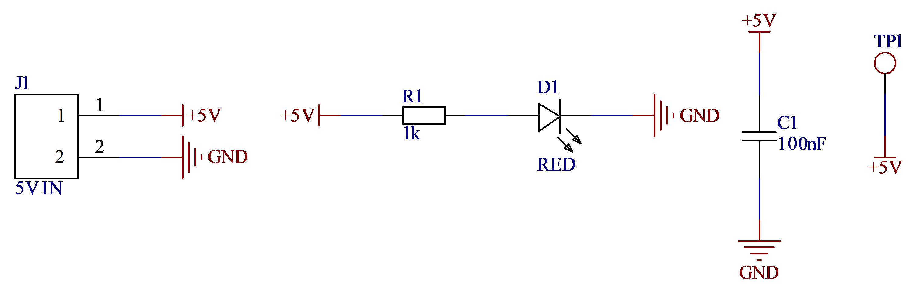

# jlc2altium

[](https://github.com/GavinnnTann/jlc2altium/actions/workflows/tests.yml)

Pick JLCPCB parts, turn them into Altium libraries with 3D models, and have an
AI agent capture and verify the schematic in Altium Designer.

Built for Windows, Altium Designer and [Claude Code](https://claude.com/claude-code),
on top of [altium-mcp](https://github.com/coffeenmusic/altium-mcp) and
[LCSC2Altium](https://github.com/Gort-Power/LCSC2Altium). Every step also works
from a plain terminal, and the part search and library import are useful
without an agent at all.



*The [LED demo](capture/examples/led_demo_spec.py): four JLC parts imported
from their LCSC codes with 3D models, then placed and wired from a short
Python spec. The audit compares Altium's compiled netlist with the spec:*

```
$ capture led_demo_spec.py audit
MATCH: Altium's compiled netlist equals the spec

Netlist for review:
  +5V         ( 4) C1.2 J1.1 R1.1 TP1.1(TP)
  GND         ( 3) C1.1 D1.2(K) J1.2
  NetD1_1     ( 2) D1.1(A) R1.2

$ capture led_demo_spec.py erc
{'total': 0, 'fatal': 0, 'errors': 0, 'warnings': 0}
```

> jlc2altium is an independent project. It is not affiliated with or endorsed
> by Altium, JLCPCB, LCSC or EasyEDA.

## What it does

| Stage | Tool | What you get |
|---|---|---|
| Choose parts | `jlcpick search`, `jlc-query` | JLC stock, Basic/Extended, price, and whether EasyEDA already has a symbol, footprint and 3D model. `jlc-query` filters the catalogue's own attributes with units, e.g. "2.2 µH, Isat ≥ 6 A, DCR ≤ 25 mΩ, smallest first". |
| Build libraries | `lcsc2altium-cli` | LCSC codes → `.SchLib` + `.PcbLib` with embedded STEP models and an `LCSC Part Number` parameter on every symbol, merged into your existing libraries. |
| Check footprints | `jlcpick verify` | Self-checks (duplicate pads, flipped copper, silk on pads) and a diff against the datasheet's recommended land pattern. |
| Capture | `capture` | A short Python spec (parts + connections) becomes placed, wired, ERC-clean Altium sheets. Wiring is drawn from pin positions measured in the saved file, not predicted. |
| Prove it | `capture audit`, `capture erc` | Altium's compiled netlist is compared with the spec. Every net is printed for a pin-by-pin review. |
| Show it | `capture render` | PNG of each sheet, drawn by Altium itself. |
| Order | `jlc-fab-export` | One folder for a JLC PCB + assembly order: Gerber and drill zip, BOM (with LCSC numbers) and CPL as Excel, and a README that lists what blocks the order (unrouted nets, missing layers, drill/copper misalignment), parts too close to the board edge, and unconfirmed rotations. |

Three Claude Code skills (`jlcpick`, `altium-capture`, `jlc-fab-export`)
teach an agent the workflow and its pitfalls. A runbook
(`templates/CLAUDE.md`) sets the ground rules for a hardware project: the
designer picks the parts, no unverified specs, every footprint verified.

## Requirements

- Windows 10/11 with Altium Designer (tested with 26.11). The part search,
  library import and footprint checks work without Altium; capture needs it
  running.
- [git](https://git-scm.com) and [uv](https://docs.astral.sh/uv/) (`winget install Git.Git astral-sh.uv`). uv provides Python 3.12.
- Claude Code (CLI or VS Code extension), optional but recommended
- About 3 GB of disk for the parts catalogue

## Install

```powershell
git clone https://github.com/GavinnnTann/jlc2altium
cd jlc2altium
powershell -ExecutionPolicy Bypass -File .\install.ps1 -FetchDb
```

The installer:

1. Clones altium-mcp and LCSC2Altium into `~\src`, at the commits
   jlc2altium was tested with (see [Tested versions](#tested-versions)).
2. Creates `~\.venvs\jlc2altium` (Python 3.12, altium-monkey, jlcpick,
   openpyxl) and altium-mcp's own environment.
3. Registers the `altium` MCP server with Claude Code at user scope, so it is
   available in every project.
4. Links the `jlcpick`, `altium-capture` and `jlc-fab-export` skills into
   `~\.claude\skills`, and clones coffeenmusic's
   [altium-scripts-skill](https://github.com/coffeenmusic/altium-scripts-skill)
   (DelphiScript API reference) next to them.
5. Puts `jlcpick`, `jlc-query`, `lcsc2altium-cli`, `fetch-jlcparts`,
   `make-misc-lib`, `altium-call`, `capture` and `jlc-fab-export` on your PATH
   (`~\.local\bin`).
6. Sets `JLC2ALTIUM_HOME`, `JLCPICK_DB`, `JLCPICK_LCSC2ALTIUM`,
   `ALTIUM_MCP_SERVER` and `LCSC2ALTIUM_SRC`.
7. With `-FetchDb`, downloads the jlcparts catalogue (about 300 MB, 2.3 GB on
   disk) and indexes it so searches take about a second. Without it, an
   existing catalogue is indexed if it is not already.
8. Runs the offline test suite.

Re-running it is safe: existing clones, environments and skill links are
left alone, and a clone that is not at the tested commit gets a warning with
the command to switch. `-Unpinned` clones the latest upstream commits
instead. Restart Claude Code afterwards so the MCP server and skills load.

## Use it with an agent

Copy `templates/CLAUDE.md` into the root of your hardware project, open
Altium, then ask, for example:

> Shortlist JLC parts for a 1-cell Li-ion charger and a 3.3 V LDO, smallest packages first.

> Capture the attached schematic into my Altium project with JLC parts, then audit the netlist and show me the sheets.

> Package the board for a JLC assembly order and tell me what still blocks it.

The skills walk the agent through shortlisting, importing, capturing,
auditing, rendering and packaging the order. The agent is told to stop and
ask before choosing parts, and never to place an order itself.

## Use it by hand

```powershell
# 1. shortlist (words are ANDed against description, MPN and package)
jlcpick search TP4056 --package ESOP --min-stock 1000
jlcpick search 3.3V LDO --package SOT-23 --basic-only
jlcpick search --category "Power Inductors" --require-3d
jlc-query --subcat "Chip Resistor - Surface Mount" --pkg 0402 --attr "Resistance=49.9kOhm" --attr "Tolerance=±1%"

# 2. import into the project library (symbols, footprints, 3D)
lcsc2altium-cli --3d --lcsc C16581,C351410 --schlib MyBoard\Libraries\MyBoard.SchLib --pcblib MyBoard\Libraries\MyBoard.PcbLib
make-misc-lib MyBoard\Libraries Misc      # test pads + net tie

# 3. verify footprints
jlcpick verify C16581

# 4. write a spec (start from capture\examples\led_demo_spec.py), then
capture myboard_spec.py setup        # sheets, libraries, global net scope
capture myboard_spec.py build all    # place, wire, tidy text, check
capture myboard_spec.py audit        # compiled netlist must MATCH the spec
capture myboard_spec.py erc
capture myboard_spec.py render out

# 5. later changes once a PCB exists: touch only what changed
capture myboard_spec.py update 2 J5 J6 U5.16   # re-place J5/J6, re-wire pin U5.16

# 6. after layout: package a JLC order (Altium open, board routed and saved)
jlc-fab-export --init MyBoard\MyBoard.PrjPcb                  # once: writes MyBoard\jlc-fab.json
jlc-fab-export --config MyBoard\jlc-fab.json --make-outline   # first export: board outline -> Mechanical 1
jlc-fab-export --config MyBoard\jlc-fab.json                 # exit 0 = ready, 2 = blockers listed
```

`update` keeps every other part's unique ID, so the next *Update PCB* in
Altium preserves your placement. `build` recreates a whole sheet, so use it
before layout starts.

A spec is plain Python:

```python
SHEETS = {1: {"file": "LED.SchDoc",
              "parts": [("R1", LIB, "0402WGF1001TCE", 2600, 3100, 0, 0, "1k"),
                        ("D1", LIB, "KT-0603R", 3200, 3050, 180, 0, "RED")],
              "conns": [("R1.1", "+5V"), ("wire", "R1.2", "D1.1"), ("D1.2", "GND")]}}
```

Connections are a stub with a net label, or a power port for rails and
grounds (`("U1.4", "VIN")`). There are also direct wires between aligned
pins, tees with a junction for shunt parts, and `None` for a no-connect.
[capture/examples/led_demo_spec.py](capture/examples/led_demo_spec.py) is a
complete example with the steps to run it.

`jlc-fab-export` writes `Project Outputs for <project>\JLC\`: the
`_Gerber.zip` for the PCB order, then `_BOM_JLC.xlsx` and `_CPL_JLC.xlsx` for
assembly. Read its `JLC_ORDER_README.md` first. It starts with NOT READY TO
ORDER when something blocks the order:
- unrouted nets
- an ECO that was not run
- a part without an LCSC code
- missing layers
- an outline that does not match the board
- drill files that do not line up with the copper

It also lists parts closer than 2.5 mm to the board edge (JLC's assembly
rule), and applies the rotation corrections logged in your project's
`docs/cpl-rotations.md`. The CPL uses the middle of each part's pads, not the
footprint origin, because converted footprints often have off-centre origins.
Reference: [docs/jlc-fab-export.md](docs/jlc-fab-export.md).

## Tested versions

| Component | Version |
|---|---|
| Altium Designer | 26.11 |
| [altium-mcp](https://github.com/coffeenmusic/altium-mcp) | `f7eabfa` (2026-11-04) |
| [LCSC2Altium](https://github.com/Gort-Power/LCSC2Altium) | `9d2cfcd` (2026-10-13) |
| [altium-scripts-skill](https://github.com/coffeenmusic/altium-scripts-skill) | `4dc1f76` (2026-04-24) |
| [altium-monkey](https://pypi.org/project/altium-monkey/) | 2026.9.22 |
| Python | 3.12 |

jlc2altium calls into altium-mcp's and LCSC2Altium's internals, so
`install.ps1` pins these commits. If you move to newer ones, run the LED
demo (setup, build, audit, erc) before trusting the result.

## Tests

The offline suite needs no Altium, altium-mcp or network, and runs on every
push ([workflow](.github/workflows/tests.yml)):

```powershell
python jlcpick\tests\test_geometry.py        # land-pattern maths, footprint self-checks
python jlcpick\tests\test_easyeda_parsing.py # EasyEDA record format
python jlcpick\tests\test_catalog.py         # search filters on a synthetic catalogue
python capture\tests\test_sheetgen.py        # wiring ops and the netlist the audit compares
python fab\tests\test_jlc_fab_export.py      # BOM/CPL rules, Gerber/drill parsing, fab checks
```

Capture itself (placing, wiring, ERC, audit) needs a running Altium. Check
it with the LED demo.

## Repository layout

```
install.ps1              one-shot Windows setup
jlcpick/                 part shortlisting, EasyEDA asset probe, footprint verify (Python package)
tools/
  lcsc2altium_cli.py     LCSC codes -> Altium libraries (LCSC2Altium wrapper, merge, cache)
  jlc_query.py           parametric catalogue search with units
  fetch_jlcparts.py      download, extract and index the split-zip jlcparts catalogue
  altium_call.py         call any altium-mcp tool from a shell
  dump_schdoc.py         dump the records of a .SchDoc (debugging)
capture/
  capture.py             setup / build / audit / erc / render from a spec
  sheetgen.py            wiring from measured pin positions
  make_misc_lib.py       test pad + net tie library with 3D bodies
  examples/              example spec
  tests/                 offline tests for the wiring logic
fab/
  jlc_fab_export.py      JLC order package: Gerber + drill zip, BOM and CPL (.xlsx), checks
  tests/                 offline tests: BOM/CPL rules, Gerber/Excellon parsing, fab checks
skills/                  Claude Code skills: jlcpick, altium-capture, jlc-fab-export
templates/
  CLAUDE.md              hardware project runbook for the agent
  cpl-rotations.md       JLC rotation-correction log, copied into a project's docs/
docs/                    jlc-fab-export reference, README image
```

## Things to know

- **Generated schematics are first drafts.** The audit proves the drawing
  matches the spec, not that the spec is right. Review the printed netlist
  against your datasheets.
- **LCSC2Altium makes every pin Passive**, so ERC cannot catch two outputs
  driving one net.
- **`capture audit` writes to your sheets.** It sets the component kind of
  `NO_BOM` and `NET_TIES` parts and saves before compiling.
- **EasyEDA rate-limits** (HTTP 403 after about 90 quick requests). Asset
  checks and imports are cached, spaced out, and fall back to `lceda.cn`,
  EasyEDA's China host. Set `JLCPICK_EASYEDA_GAP` (seconds) to slow them
  further.
- **Stock goes stale.** The catalogue is a snapshot: re-check with
  `jlcpick search --live` before ordering.
- **Rendering uses the clipboard.** Altium window screenshots are often stale,
  so `capture render` has Altium copy each sheet as a metafile. That
  overwrites your clipboard.
- **Content Vault parts** (Altium's Manufacturer Part Search) carry no LCSC
  number. Use LCSC imports when the board is assembled at JLC.
- **`jlc-fab-export` writes to your project.** It adds `JLC Fabrication.OutJob`
  to the project (rewritten on every run), and `--make-outline` draws the board
  outline on Mechanical 1 and saves the PCB.
- **Rotations are unconfirmed until JLC's preview shows them.** The export
  lists every footprint not yet in `docs/cpl-rotations.md`. Check polarised
  parts in JLC's placement preview, then log what JLC corrected (and `0` for
  footprints that came out right), so the next export gets them right.
- **Edge clearance is measured to the outline's bounding box**, which is
  exact for rectangular boards. On round or irregular boards, check parts
  near curved edges yourself.

## Credits

- [altium-mcp](https://github.com/coffeenmusic/altium-mcp) (MIT): the Altium
  bridge, schematic tools and checks this builds on. The metafile render
  technique comes from its `dev/render_sheet.py`.
- [LCSC2Altium](https://github.com/Gort-Power/LCSC2Altium) (MIT): EasyEDA →
  Altium library conversion.
- [altium-monkey](https://pypi.org/project/altium-monkey/): Altium file reader/writer.
- [jlcparts](https://github.com/yaqwsx/jlcparts): the JLC catalogue.
- [easyeda2kicad](https://github.com/uPesy/easyeda2kicad.py),
  [jlcsearch](https://jlcsearch.tscircuit.com).
- [altium-scripts-skill](https://github.com/coffeenmusic/altium-scripts-skill):
  not included here, the installer clones it.

## License

MIT. See [LICENSE](LICENSE).
